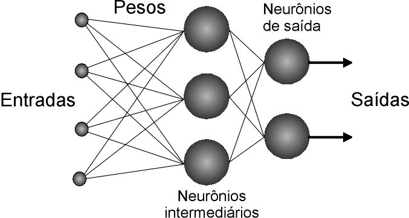

Node é a estrutura de dados que mantém uma rede neural, ele processa informações e passa para o próximo node, para no final da rede neural ela entregará o resultado final

Um node armazena informações dentro dele, como:
	- **State**
	- **Parent** (node anterior ao node atual, o node que o gerou)
	- **Action** (ação aplicada pelo parent, que gerou o node)
	- **Path cost** (desde o initial state até o node)

### Estrutura:
	Entrada 1 ----\
               > 	[ Node ] ---> Saída
	Entrada 2 ----/

---

O node realiza três etapas principais:
1. **Recebe as entradas** (números).
2. **Multiplica cada entrada por um peso** (que representa a importância daquela informação).
3. **Aplica uma função de ativação** para decidir qual será a saída.

### Matematicamente:
$$
\text{Saída} = f(w_1x_1 + w_2x_2 + b)
$$
	Onde:
	- $x_1, x_2$ = entradas
	- $w_1, w_2$ = pesos
	- $b$ = viés (bias)
	- $f$ = função de ativação

---

### Exemplo:
Suponha que você queira que uma IA identifique se uma imagem contém um cachorro.

Um node pode receber informações como:
- Formato das orelhas
- Comprimento do focinho
- Presença de pelos

Cada característica recebe um peso diferente. O node combina tudo isso e produz um valor que indica o quanto aquela informação sugere que existe um cachorro na imagem.

---

### Imagem Ilustrativa

---

Related: [Setting the terms](./Setting%20the%20terms.md)